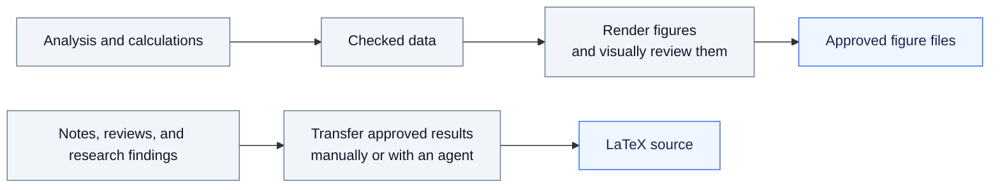
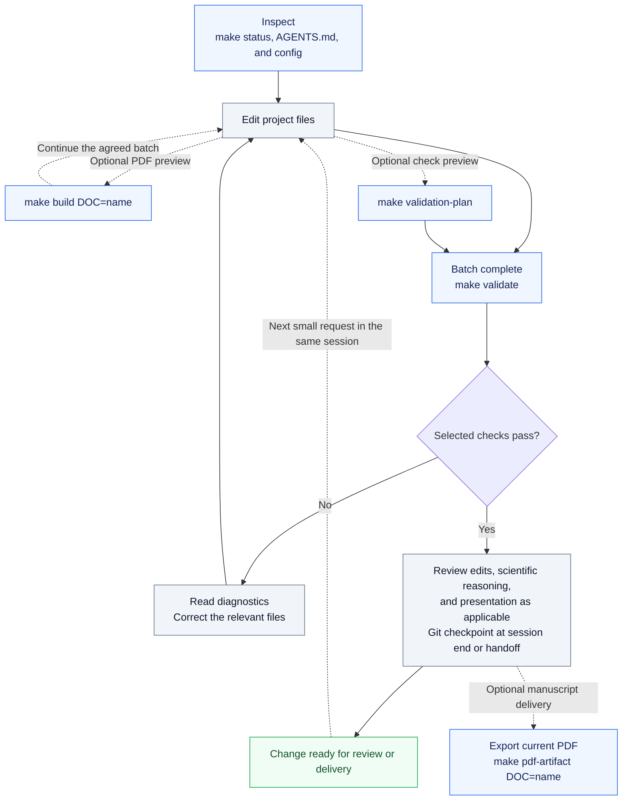
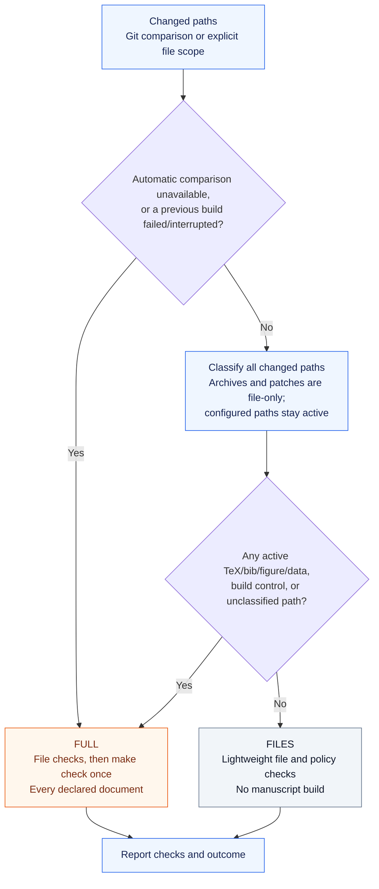

# Workflow at a glance

These diagrams show the Workbench 6 workflow. GitHub renders the Mermaid diagrams
directly; their source stays editable alongside the documentation.

## Research and manuscript inputs

Research tools are explicit project operations. Run the relevant numerical tests
and review results before transferring them into the manuscript.

Ordinary Markdown, JSON, and Python are working material. Workbench does not
automatically run calculations or render figures. A project's configured custom
builder still performs whatever that project explicitly declares as its build.

## The daily loop

Start from the project root. Before a risky edit or upgrade, use
[`make snapshot`](snapshots.md) to keep a recoverable copy outside the project.

`make validate` prints its own plan. Use `make validation-plan` separately only
when the preview affects a decision. Run validation at the end of the requested
batch, before delivery or Git handoff; a single editing request ends at delivery.
A PDF preview during an ongoing batch is not completed validation.

Git inspection follows the editing session, which may span successive requests.
Inspect branch/status and relevant diffs at its start, and review the relevant
diff and status at its completion or Git handoff. Between those checkpoints,
read the current target passage before patching it and refresh relevant Git
checks when state/context changes. Completing a validation batch does not itself
end this session. See [successive edits](daily-use.md#git-inspection-during-successive-edits).

Export requires a current build receipt and verifies the PDF before copying it
to `.latex-ai/artifacts/documents/NAME/document.pdf`. If a manuscript build is
needed, run `make check` first. Preparing or replacing delivery copies is a
separate deliberate step; export does not replace supplied delivery PDFs.

## What validation selects

`make validation-plan` explains this decision without running checks.
`make validate` executes the selected level. Mixed changes select Full if any
non-exempt changed path requires it.

- Historical directories are named exactly `archive`, at any depth. Their contents
  remain file-only regardless of extension, except paths `.latex-ai.json` names.
  Copy or move a historical file out before making it an active build input. `.diff` and
  `.patch` files receive text-integrity checks without interpreting embedded code.
- Ordinary Markdown/JSON/Python changes get file checks. Configured builders,
  lint baselines, Makefiles, project/runtime settings, and editor integration are
  build controls even when their extension is JSON or Python.
- A clean Git comparison with no failed build selects no manuscript check.
  Without Git/history, automatic selection uses Full; explicit `--files` scope
  remains available. See [comparison and recovery](validation.md#comparison-and-recovery).
- Full validation covers every declared document, including projects with shared
  outputs or cross-references. latexmk recompiles only what changed; a configured
  `build_command` is invoked each time and may implement incremental work using
  the [freshness hint](configuration.md#build-receipts-and-recovery). Reference verification and lint still run. Numerical tests and visual review
  remain task-specific work.

A **current build** means its inputs and outputs match its receipt. It does not
mean lint passed or the science is correct. A **Files pass** does not certify a PDF.
See the [complete routing rules](validation.md) and [build receipts](architecture.md).

For deliberate single-document work, use `make document-check DOC=name` or
`make build DOC=name`. For the whole manuscript, `make check` always checks all
declared documents. See [daily use](daily-use.md) and [named documents](tex-notes.md).
